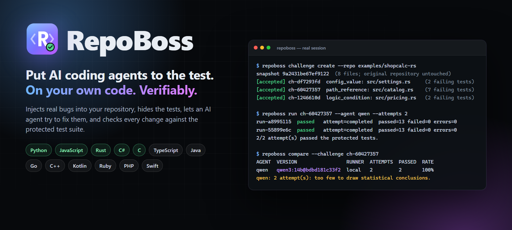
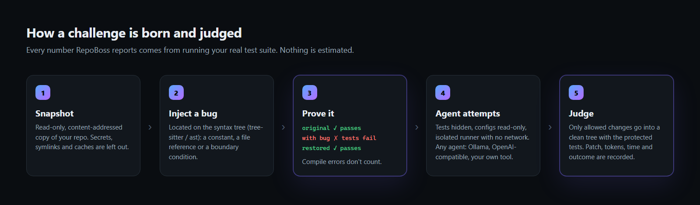
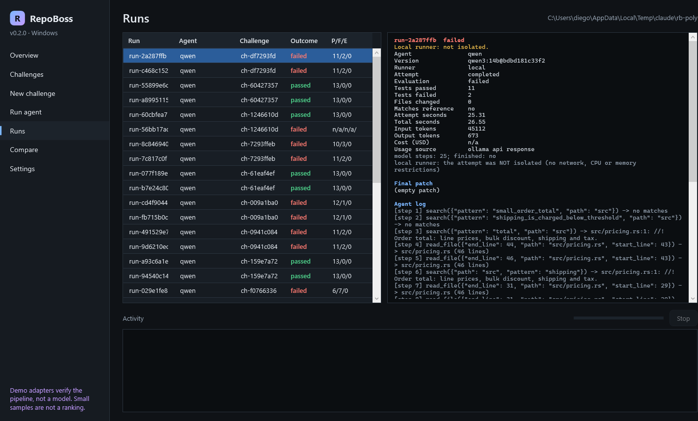
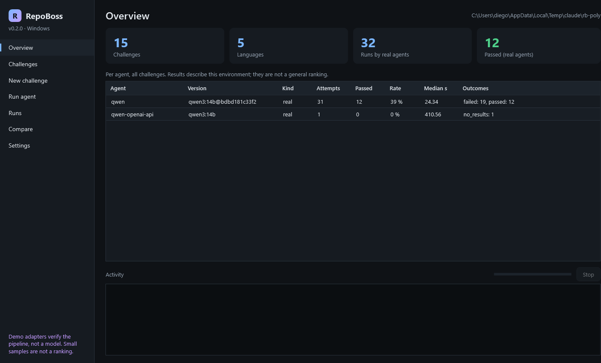
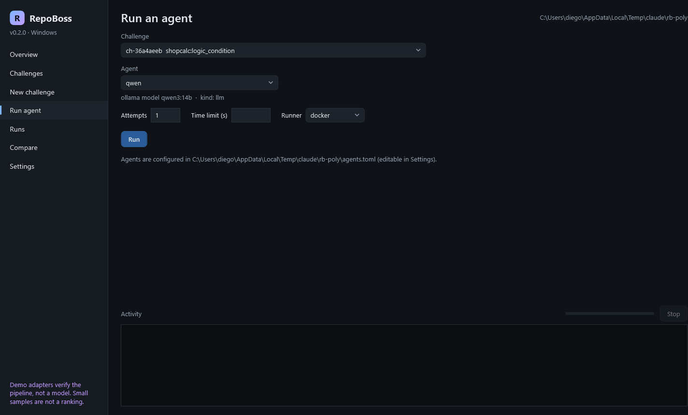
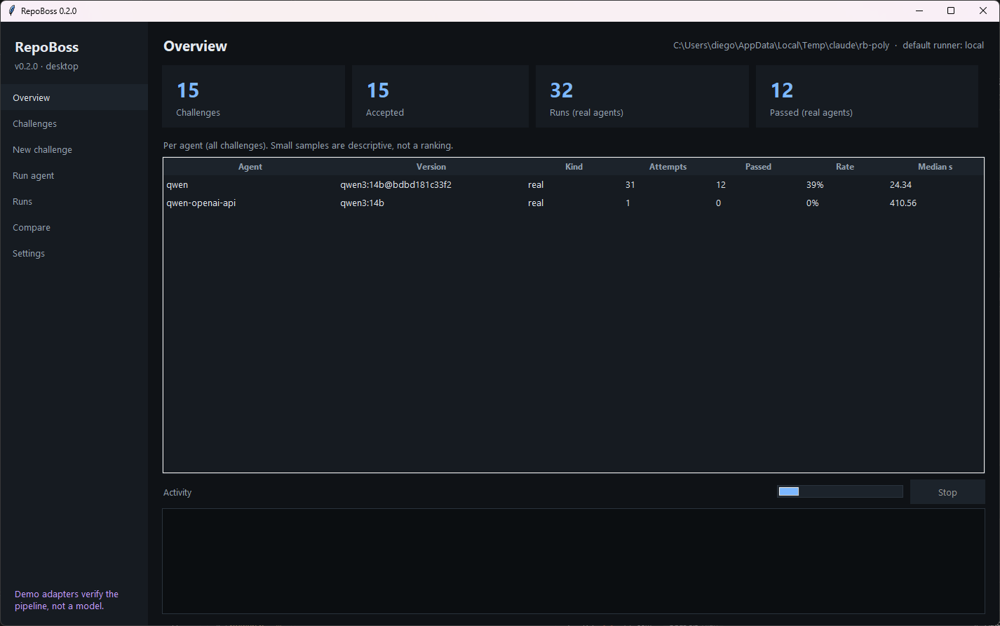
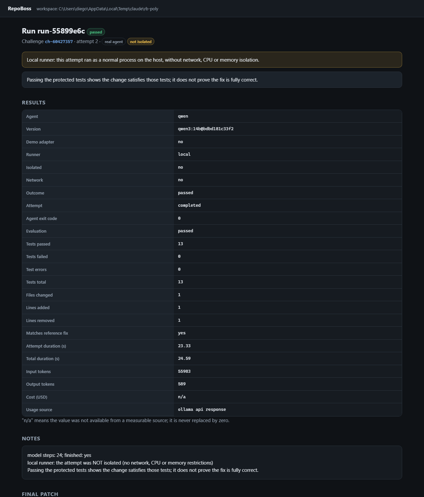

<p align="center">
  
</p>

<p align="center">
  <a href="https://repoboss.pages.dev"><b>Website</b></a> ·
  <a href="#quick-start">Quick start</a> ·
  <a href="#put-a-real-ai-agent-to-the-test">AI agents</a> ·
  <a href="#real-results">Real results</a> ·
  <a href="#four-ways-to-use-it">Apps</a> ·
  <a href="docs/challenge-format.md">Docs</a> ·
  <a href="https://github.com/diegobruvhrpiugvjrigjtibjte/repoboss/releases/latest">Download</a>
</p>

<p align="center">
  
  
  
  
  
  
</p>

# RepoBoss

**RepoBoss turns your own repository into verifiable code-repair challenges, then measures how AI
coding agents do on them.**

It injects one real bug, proves the bug is fair, hides the tests, and lets an agent try to fix it.
Every change is then judged against your protected test suite.

Benchmarks built on somebody else's code tell you little about *your* stack. RepoBoss answers the
question you actually have: **which agent fixes bugs in my code, how often, at what cost in tokens and
time?**

> Passing the protected tests shows that a change satisfies those tests. It does not prove the fix is
> fully correct. RepoBoss says so on every passing run.

---

## Table of contents

- [Why RepoBoss](#why-repoboss)
- [How it works](#how-it-works)
- [Real results](#real-results)
- [Quick start](#quick-start)
- [Put a real AI agent to the test](#put-a-real-ai-agent-to-the-test)
- [Four ways to use it](#four-ways-to-use-it)
- [Languages and test frameworks](#languages-and-test-frameworks)
- [Use your own repository](#use-your-own-repository)
- [Security and isolation](#security-and-isolation)
- [What gets recorded](#what-gets-recorded)
- [Command reference](#command-reference)
- [Architecture](#architecture)
- [Project status](#project-status)
- [FAQ](#faq)
- [Contributing and license](#contributing-and-license)

---

## Why RepoBoss

| | Public benchmarks | **RepoBoss** |
|---|---|---|
| Code under test | Someone else's projects | **Your repositories** |
| Languages | Usually one | **17 for bug injection; 5 verified end to end** |
| Can the agent cheat by editing tests? | Depends | **No: tests hidden, configuration read-only, clean re-evaluation** |
| Are the challenges fair? | Assumed | **Proven: original passes, bug fails tests, restored passes byte for byte** |
| Cost and tokens | Rarely | **From the API's own usage fields; never invented** |
| Result | A leaderboard | **Your numbers, with a warning when the sample is small** |

## How it works

<p align="center"></p>

1. **Snapshot.**
   - A read-only, content-addressed copy of your repository.
   - Your files and your git index are never modified.
   - Secrets, symlinks and caches are excluded, and each skipped file is reported.
2. **Inject one bug.** The bug is located on the syntax tree: Python `ast` for Python, tree-sitter
   for everything else.
   - Each edit records the exact span and the file hashes before and after.
   - The inverse edit restores the original byte for byte.
   - Nothing is ever done by search-and-replace.
3. **Prove the challenge is fair.** Each check runs in a fresh copy:
   - the original passes;
   - the buggy version **fails tests**;
   - the restored version is byte-identical and passes.

   Compile errors, collection errors, timeouts and missing dependencies are rejected, because a
   compiler pointing at the bug is not a challenge.
4. **The agent tries.**
   - Test files are removed from its copy, and build/test configuration is read-only.
   - The isolated runner gives it no network by default.
   - Each attempt starts from a clean copy, with a time limit.
5. **Judge.** Only allowed changes are transferred into a clean tree that holds the protected tests.
   - Links, oversized files and edits to protected paths reject the attempt.
   - RepoBoss records the outcome, test counts, patch, tokens, model version and durations.

### The three kinds of bugs

| Transform | Example | What it tests |
|---|---|---|
| `config_value` | `TAX_RATE = 0.22` → `0.44` | Spotting a wrong constant without seeing the tests |
| `path_reference` | `"catalog.csv"` → `"catalogs.csv"` | Following a broken data-file reference |
| `logic_condition` | `quantity <= 0` → `quantity < 0` | Boundary reasoning (off-by-one, `&&`/`\|\|`, `==`/`!=`) |

Generic type arguments (`List<String>`), interpolated strings, code imports and files with inline tests
are never mutated.

## Real results

**Setup:**
- `qwen3:14b@bdbd181c33f2` through Ollama 0.35, on a desktop GPU (RX 9060 XT), with
  `think = false`;
- the local runner;
- 15 challenges across five languages, 2 attempts each (3 for one).

Every number below is copied from the RepoBoss database.

| Language | Bug | Passed | Outcomes | Median s | Median tokens in / out |
|---|---|---|---|---|---|
| Python | `config_value` | 0/2 | failed | 37 | 53103 / 564 |
| Python | `logic_condition` | 0/2 | failed | 43 | 39489 / 599 |
| Python | `path_reference` | **2/2** | passed | 8 | 4087 / 129 |
| JavaScript | `config_value` | 0/2 | failed | 17 | 27053 / 439 |
| JavaScript | `logic_condition` | 0/3 | failed | 7 | 3191 / 166 |
| JavaScript | `path_reference` | **2/2** | passed | 7 | 6238 / 177 |
| Rust | `config_value` | 0/2 | failed | 28 | 47575 / 683 |
| Rust | `logic_condition` | 1/2 | failed (does not compile), passed | 27 | 29707 / 699 |
| Rust | `path_reference` | **2/2** | passed | 25 | 57342 / 588 |
| C# | `config_value` | 0/2 | failed | 24 | 41056 / 485 |
| C# | `logic_condition` | **2/2** | passed | 17 | 8816 / 249 |
| C# | `path_reference` | 1/2 | failed, passed | 26 | 48160 / 548 |
| C | `config_value` | 0/2 | failed | 27 | 47170 / 666 |
| C | `logic_condition` | 0/2 | failed | 24 | 57505 / 535 |
| C | `path_reference` | **2/2** | passed | 12 | 11111 / 242 |

**12 of 31 attempts passed.** With two or three attempts per row, this describes one model on one
small project; it is not a ranking.

The pattern is still informative:
- **Broken file name (`path_reference`):** visible in the code, and fixed 9 times out of 10.
- **Changed constant (`config_value`):** not visible. With the tests hidden, the right value cannot
  be inferred, so it was fixed 0 times out of 10.

This is the kind of insight RepoBoss is built to surface about your own setup.

## Quick start

**Requirements:**
- Python 3.12+;
- the toolchain of the language you test (node, cargo, dotnet, cmake…);
- Docker for isolated runs, recommended for any agent or code you do not fully trust.

```bash
pip install git+https://github.com/diegobruvhrpiugvjrigjtibjte/repoboss
repoboss doctor                                    # checks Python, git, Docker
repoboss init --runner local                       # or plain `repoboss init` with Docker running
```

Try the whole pipeline on the bundled example, with no AI involved:

```bash
git clone https://github.com/diegobruvhrpiugvjrigjtibjte/repoboss && cd repoboss
repoboss challenge create --repo examples/shopcalc
repoboss run ch-XXXXXXXX --agent demo-oracle --attempts 3   # use an id printed above
repoboss run ch-XXXXXXXX --agent demo-noop
repoboss compare --challenge ch-XXXXXXXX
repoboss gui                                        # or: repoboss dashboard / repoboss interactive
```

`demo-oracle` applies the known fix and `demo-noop` does nothing. Together they show that the pipeline
passes a correct fix and fails a missing one. They are labelled **DEMO** everywhere and **never
measure a model**.

The same example project exists in five languages: `examples/shopcalc` (Python), `shopcalc-js`,
`shopcalc-rs`, `shopcalc-cs` and `shopcalc-c`, each with 13 real tests.

## Put a real AI agent to the test

RepoBoss contains a complete tool-using coding agent. A language model drives it through these tools:

| Tool | What it does |
|---|---|
| `list_files` | List files in the working copy |
| `read_file` | Read a file, with line numbers |
| `search` | Regular-expression search across files |
| `replace_in_file` | Exact replacement; the old text must occur exactly once |
| `write_file` | Create or overwrite a file |
| `finish` | End the attempt |
| `run` | Run a command without network; off by default |

Every path is checked, and tests and configuration cannot be written. Each step is saved in a
transcript.

**A local model through [Ollama](https://ollama.com)**, no account needed:

```toml
# .repoboss/agents.toml
[agents.qwen]
type = "llm"
provider = "ollama"
model = "qwen3:14b"
timeout_s = 900
```

**Any OpenAI-compatible API** (OpenAI, OpenRouter, Groq, LM Studio, vLLM…):

```toml
[agents.gpt]
type = "llm"
provider = "openai"
base_url = "https://api.openai.com/v1"
model = "gpt-4.1-mini"
api_key_env = "OPENAI_API_KEY"   # read from your environment, never stored
price_input_per_mtok = 0.40      # optional: enables a computed cost
price_output_per_mtok = 1.60
```

```bash
repoboss run ch-XXXXXXXX --agent qwen --attempts 5
repoboss compare --challenge ch-XXXXXXXX
repoboss runs show run-XXXXXXXX --log --patch
```

**Your own tool:**
- any non-interactive agent plugs in as a **command agent**;
- it gets a working copy, a task file and documented environment variables;
- it may report its usage in `usage.json`;
- see [docs/agents.md](docs/agents.md).

**Verified providers:**
- Ollama (`qwen3:14b`, real runs).
- The OpenAI-compatible protocol, against Ollama's `/v1` endpoint. Hosted services were not tested with
  a key.
- There is no native Claude Code or Anthropic integration yet: none has been verified against the real
  tool.

## Four ways to use it

All interfaces drive the same engine, so a challenge created in one shows up in the others.

### Native Windows app (WPF, .NET 8)


- **Sections:** Overview, Challenges, New challenge (folder picker and auto-detect), Run agent, Runs
  (colored diffs and agent logs), Compare and Settings (edit `agents.toml`).
- **Download:** `RepoBoss-Windows-x64.zip` from the
  [latest release](https://github.com/diegobruvhrpiugvjrigjtibjte/repoboss/releases/latest). It needs
  the .NET 8 Desktop Runtime and the `repoboss` command installed.

<table><tr>
<td></td>
<td></td>
</tr></table>

### Cross-platform desktop app (Python + Tkinter)


`repoboss gui` opens a dark desktop app on Windows, macOS and Linux, with no extra dependencies. On
Debian/Ubuntu, install `python3-tk` first.

### Web dashboard


`repoboss dashboard` serves a local, read-only dashboard at http://127.0.0.1:8765. It shows:
- challenges and runs;
- comparisons and patches;
- clear **DEMO** and **not isolated** labels.

### Terminal
- **The full CLI:** for scripts and CI.
- **`repoboss interactive`:** guided menus with numbered lists, so there are no flags to remember.
- **`repoboss json …`:** machine-readable output used by the desktop apps.

### macOS native app (SwiftUI): source available
`macos/` contains a SwiftUI app with the same sections as the Windows app, and a `build-app.sh` script.
**It has not been compiled on a Mac yet**, so it ships as source only. On macOS today, use
`repoboss gui`, the dashboard or the terminal.

## Languages and test frameworks

| Level | Languages |
|---|---|
| **End to end with real toolchains** (`tests/test_multilang_e2e.py`) | Python (pytest), JavaScript (node:test), Rust (cargo), C# (.NET 8 + xUnit), C (CMake + CTest + Ninja) |
| **Bug injection unit-tested** | TypeScript, Java, Go, Kotlin, Ruby, PHP |
| **Supported grammars** | C++, Swift, Dart, Scala, Lua, Elixir, Zig |

**Test results are recognised from:**
- JUnit XML;
- built-in parsers for pytest, unittest, jest, vitest, node:test, mocha, ava, cargo, go test,
  Maven, Gradle, dotnet test, RSpec, Minitest, PHPUnit, CTest, dart test and mix test.

A non-zero exit without recognisable results counts as a build error, never as a test failure.

## Use your own repository

```bash
repoboss detect --repo path/to/project          # proposes a repoboss.toml; nothing is written there
repoboss challenge create --repo path/to/project --per-transform 3
```

**Detection:**
- **Covers:** npm, pnpm and yarn (jest, vitest, mocha, ava, node:test), Python, Cargo, Go, .NET,
  Maven, Gradle, Bundler, Composer, CMake, Mix and Dart.
- **Without a `repoboss.toml`:** the detected configuration is used and saved under
  `.repoboss/configs/`.

Example configuration:

```toml
[repoboss]
install = [["npm", "ci"]]                 # once per environment, network allowed
build = []                                # compiled in each fresh tree (e.g. CMake)
test = ["npm", "test"]                    # argv list, never a shell string
test_framework = "jest"
dependency_dirs = ["node_modules"]        # linked into each tree, never copied
hidden = ["**/*.test.js", "test/**"]      # removed from the agent's copy
protected = ["package.json"]              # visible but read-only
editable = ["src/**"]
```

Every field is described in [docs/challenge-format.md](docs/challenge-format.md).

## Security and isolation

**The Docker runner:**
- installs dependencies into an image, then **deletes every non-dependency file** from it, so neither
  the original source nor the tests remain there;
- runs each attempt and each evaluation in a fresh container:
  - `--network none` unless enabled;
  - CPU, memory and PID limits;
  - `--cap-drop ALL` and `no-new-privileges`;
  - **no host folders mounted**: files travel as tar streams, and links coming back are rejected.

**The local runner** is for trusted code. It runs commands as you, passes only an allowlist of
environment variables (no API keys), and labels every run **not isolated**.

**Everything else:**
- Commands are argv lists end to end, never shell strings.
- Imported challenge packages are hash-checked, rejected on traversal or links, and never executed
  without `--trust`.
- The dashboard binds to localhost.
- Docker reduces risk; it is not a perfect boundary.

See [SECURITY.md](SECURITY.md).

## What gets recorded

For every attempt, in SQLite:

| Group | Fields |
|---|---|
| Agent | name, version (and how it was obtained), whether it is a demo adapter |
| Environment | runner, isolation, network, and the image or interpreter |
| Statuses | preparation, attempt and evaluation, with exit codes |
| Tests | passed / failed / errors / skipped / total, and the failing test ids |
| Changes | the final patch, files and lines changed, whether it matches the reference fix |
| Usage | durations, input and output tokens, cost, and their source |

Values that were not measured stay **empty (`n/a`), never zero**. Comparisons show the number of
attempts and the success rate, and warn when the sample is too small for statistical conclusions.

## Command reference

| Command | Purpose |
|---|---|
| `repoboss doctor` | Check Python, git, Docker and the workspace |
| `repoboss init [--runner docker\|local]` | Create `.repoboss/` (database, settings, agents) |
| `repoboss detect --repo PATH [--out FILE]` | Propose a configuration for a project |
| `repoboss languages [--download]` | Languages for bug injection; fetch grammars for offline use |
| `repoboss challenge create --repo PATH [--config F] [-t NAME]... [--seed N] [--per-transform N]` | Snapshot and create verified challenges |
| `repoboss challenge verify ID [--trust]` | Re-run the original / buggy / restored checks |
| `repoboss challenge list` / `show ID [--reveal]` | Inspect challenges |
| `repoboss run ID --agent NAME [--attempts N] [--network] [--timeout S]` | Run attempts from clean copies |
| `repoboss runs list` / `runs show RUN [--patch] [--log]` | Inspect runs |
| `repoboss compare RUN1 RUN2 ...` / `compare --challenge ID` | Side by side, or per-agent summary |
| `repoboss export ID` / `repoboss import FILE` | Inspectable zip packages with a versioned manifest |
| `repoboss gui` / `dashboard` / `interactive` | Desktop app, web dashboard, guided terminal |
| `repoboss json status\|challenges\|challenge\|runs\|run\|agents\|stats` | Machine-readable output |

All commands accept `--home DIR` (or `REPOBOSS_HOME`).

## Architecture

```
src/repoboss/
  cli.py          Typer CLI and JSON API             interactive.py  guided terminal menus
  config.py       repoboss.toml                      detect.py       project-type detection
  snapshot.py     read-only content-addressed copy   transforms.py   edits + Python AST transforms
  polyglot.py     tree-sitter transforms (17 langs)  results.py      JUnit + 18 framework parsers
  testing.py      build/test runs and statuses       challenge.py    acceptance (original/bug/restored)
  runners.py      local runner + Docker runner        procs.py        timeouts, tree kill, capped logs
  agents.py       demo / command / llm adapters      llm_agent.py    tool-using agent loop
  evaluation.py   change collection, clean eval tree run.py          one attempt end to end
  compare.py      aggregation                         packaging.py    export/import
  workspace.py    SQLite + paths                      gui.py          Tkinter desktop app
  dashboard/      FastAPI + Jinja2 web dashboard
windows/          native WPF app (.NET 8)             macos/          SwiftUI app (source)
examples/         shopcalc in Python, JS, Rust, C#, C (13 tests each) + agent skeleton
tests/            141 tests, including real-toolchain end-to-end runs
```

## Project status

| Area | State |
|---|---|
| Engine, CLI, database, comparison, export/import, dashboard, desktop app, interactive terminal | Tested on Windows 11, Python 3.12 |
| Real toolchains end to end | Python, JavaScript, Rust, C#, C |
| Real AI agent | qwen3:14b through Ollama, 31 attempts in 5 languages |
| Native Windows app | Built and run on Windows 11 (screenshots above come from it) |
| macOS SwiftUI app | **Source only, never compiled** |
| Docker runner | Implemented, with file transfer and commands unit-tested. **Not yet run end to end**: no Docker daemon was available |
| Linux and macOS runs of the test suite | Not run yet |

**Roadmap:**
- verify the Docker runner;
- give agents the failing test output as an option (the `config_value` finding above);
- add native providers once they can be verified;
- run on more real-world repositories.

## FAQ

<details><summary><b>Is this a leaderboard of models?</b></summary>
No. RepoBoss measures agents on your repositories, in your environment. With few attempts it shows
descriptive numbers and says so.</details>

<details><summary><b>Can the agent cheat by editing the tests?</b></summary>
The tests are not in its copy, configuration files are read-only, and the evaluation rebuilds a clean
tree from the original snapshot. Touching a protected path rejects the attempt.</details>

<details><summary><b>Why are compile errors rejected as challenges?</b></summary>
A compiler points straight at the bug. A good challenge builds and fails a test, so the agent has to
understand the code.</details>

<details><summary><b>Does it work without an AI account?</b></summary>
Yes. Use a local model through Ollama, or try the pipeline with the clearly labelled demo adapters.</details>

<details><summary><b>Does it support Claude Code, Codex or other hosted agents?</b></summary>
Not natively yet. Any agent that runs non-interactively can be plugged in as a command agent.</details>

## Contributing and license

Contributions are welcome. Read [CONTRIBUTING.md](CONTRIBUTING.md) and [CLAUDE.md](CLAUDE.md) (an
architecture map), and run `ruff check`, `ruff format --check`, `mypy` and `pytest` before opening a
PR. To report a security issue, see [SECURITY.md](SECURITY.md).

**Continuous integration:** the CI workflow lives in `ci/github-actions.yml`. Copy it to
`.github/workflows/ci.yml` to enable it, including the Docker job.

MIT License, see [LICENSE](LICENSE). Website: **https://repoboss.pages.dev**
